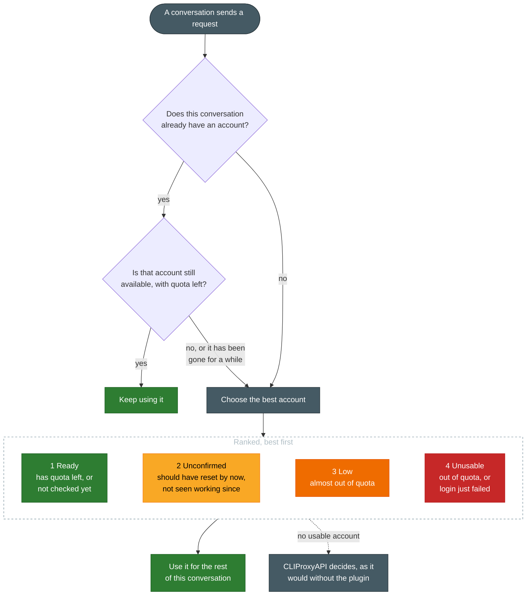

# CLIProxyAPI Expiring Quota First

[](https://github.com/stavarengo/CLIProxyAPI-Expiring-Quota-First/actions/workflows/ci.yml)
[](https://github.com/stavarengo/CLIProxyAPI-Expiring-Quota-First/releases/latest)
[&replace=%241&label=built%20for%20CLIProxyAPI)](https://github.com/router-for-me/CLIProxyAPI)
[](LICENSE)

Spend your Claude and Codex weekly quotas before they reset.

A scheduler plugin for [CLIProxyAPI](https://github.com/router-for-me/CLIProxyAPI), for anyone running two or more Claude or Codex subscriptions behind it.
Without it, one account hits its weekly limit while another still has half its week unused, and on reset day that half is gone.
With it, each new session, meaning each new Claude Code or Codex CLI conversation, goes to the account whose quota resets soonest, so the quota about to expire is the one you burn.

## What you get

- Sessions are sticky. A conversation stays on its account, across CLIProxyAPI restarts too, and moves only when that account is used up, its login is rejected, or CLIProxyAPI stops offering it.
- New sessions avoid accounts that are used up, nearly used up, or whose login was rejected, as long as another account is ready.
- Claude's separate weekly limit on its top model is tracked as well, so a session for that model avoids an account that is out of it. As of 2026-10 that model is Fable, on Max plans.
- A Claude Code subagent gets the same account as the conversation that started it.
- It starts in shadow mode: it records each pick it would have made, with the reason, in a [state file](docs/state-file.md), and routes nothing until you switch it to active. Until then CLIProxyAPI routes as before.
- The plugin's data stays on your machine. It learns quota from the rate-limit headers CLIProxyAPI already receives, makes no network calls of its own, and writes no keys or raw session ids to disk.

## How it picks an account



Only the weekly quota counts; the five-hour limits are ignored.
Among ready accounts the soonest weekly reset wins, except that an account whose reset time is still unknown is tried first, so the plugin learns it.
A session keeps its account until it has been idle for a week, by default.
[Configure](docs/configure.md) has the timing and threshold settings, and [Known limits](docs/known-limits.md) what the plugin cannot see.

## Try it

Releases are for Linux and built for the CLIProxyAPI version in the badge above; [Install](docs/install.md) has the details.

1. Add this repository's `registry.json` as a plugin store source in CLIProxyAPI's `config.yaml`. Skip this step when the plugin store page of your management console already lists the plugin:

   ```yaml
   plugins:
     store-sources:
       - "https://raw.githubusercontent.com/stavarengo/CLIProxyAPI-Expiring-Quota-First/main/registry.json"
   ```

2. Install `Expiring Quota First` from the plugin store page of your management console.

3. Turn plugins on and start in `shadow` mode. The plugin's own `enabled` is already there from the store install; the global `plugins.enabled` is off while missing, so add it. The block should read:

   ```yaml
   plugins:
     enabled: true
     configs:
       expiring-quota-first:
         enabled: true
         mode: shadow
   ```

4. After some traffic, read the picks in the [state file](docs/state-file.md). Once they are the accounts you would have chosen, set `mode: active`.

## Read more

- [Install](docs/install.md): which CLIProxyAPI versions and platforms a release fits, the management API call, and installing by hand.
- [Configure](docs/configure.md): every setting with its default, and where the state lives.
- [State file](docs/state-file.md): what the plugin records, and how to read its picks.
- [Known limits](docs/known-limits.md): what the plugin does not see or decide.
- [Develop](docs/develop.md): tests, reproducing a release build, and releasing.

## License

[MIT](LICENSE)
