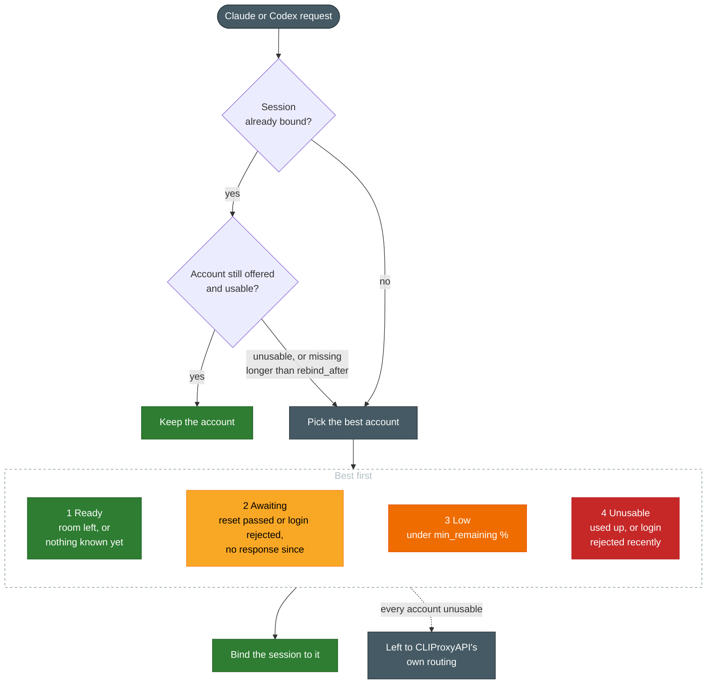

# CLIProxyAPI Expiring Quota First

[](https://github.com/stavarengo/CLIProxyAPI-Expiring-Quota-First/actions/workflows/ci.yml)
[](https://github.com/stavarengo/CLIProxyAPI-Expiring-Quota-First/releases/latest)
[&replace=%241&label=built%20for%20CLIProxyAPI)](https://github.com/router-for-me/CLIProxyAPI)
[](LICENSE)

A scheduler plugin for [CLIProxyAPI](https://github.com/router-for-me/CLIProxyAPI) that spends your Claude and Codex weekly quotas before they reset.
Each new session, one conversation of a client such as Claude Code or the Codex CLI, goes to the account whose weekly quota resets soonest and stays there, across CLIProxyAPI restarts too.
It is for setups where two or more Claude or Codex subscriptions sit behind one CLIProxyAPI and one account keeps hitting its weekly limit while another sits idle.

It reads the quota from the rate-limit headers CLIProxyAPI already receives, so it holds no tokens and makes no network calls of its own.
Requests for other providers, and routes that mix providers, are left to CLIProxyAPI's own routing.

## Quick start

1. Add this repository's `registry.json` as a plugin store source in CLIProxyAPI's `config.yaml` (not needed once the plugin is in the official store):

   ```yaml
   plugins:
     store-sources:
       - "https://raw.githubusercontent.com/stavarengo/CLIProxyAPI-Expiring-Quota-First/main/registry.json"
   ```

2. Install `Expiring Quota First` from the plugin store page of your management console, or through the management API:

   ```bash
   curl -X POST -H "Authorization: Bearer <management key>" \
     http://<cliproxyapi>/v8/management/plugins/store/expiring-quota-first/install
   ```

3. Set the global `plugins.enabled`, which CLIProxyAPI treats as off while it is missing, and start in `shadow` mode, where the plugin only records what it would pick. The plugin's own `enabled` is already there, written by the store install:

   ```yaml
   plugins:
     enabled: true
     configs:
       expiring-quota-first:
         enabled: true
         mode: shadow
   ```

4. After some traffic, read the picks in the [state file](#state-file). Once they are the accounts you would have chosen, set `mode: active`.

## How it picks an account



Only the weekly quota counts; the five-hour limits are ignored.
Among ready accounts, one with an unknown reset time goes first so traffic learns it, then the soonest weekly reset, then accounts whose responses carry no weekly quota, such as plain API keys.
A binding lasts until the session has been idle for `ttl`.
Claude Code subagents carry their parent's session id, so they take the parent's account.
`ttl`, `rebind_after` and `min_remaining` are settings; [Configure](#configure) has their defaults.

## Install

Each release is built for the CLIProxyAPI version in `go.mod` at the time, shown in the badge above and in the release notes.
When the plugin interface of your CLIProxyAPI differs, CLIProxyAPI logs `pluginhost: failed to load plugin` and routes with its own rules.

Releases cover linux/amd64 and linux/arm64, built on the same Debian version as the official `eceasy/cli-proxy-api` image, pinned in `build.sh`, so they need no newer glibc than that image has.
For another platform, [build it yourself](#develop).

The store install from the [quick start](#quick-start) checks the download against the release's `checksums.txt`, installs it into CLIProxyAPI's `plugins` folder and loads it without a restart.
To install by hand, download `expiring-quota-first_<version>_<os>_<arch>.zip` from the [latest release](https://github.com/stavarengo/CLIProxyAPI-Expiring-Quota-First/releases/latest), check it against `checksums.txt`, put the `expiring-quota-first.so` inside into the `plugins` folder without renaming it (CLIProxyAPI takes the plugin id from the file name), and restart CLIProxyAPI.

## Configure

The full set with its defaults, in CLIProxyAPI's `config.yaml`:

```yaml
plugins:
  enabled: true  # CLIProxyAPI's own flag; off while missing
  dir: "plugins"
  configs:
    expiring-quota-first:
      enabled: true
      priority: 0       # order among scheduler plugins, CLIProxyAPI's own
      mode: shadow      # or active
      ttl: 168h
      rebind_after: 15m
      min_remaining: 5  # percent of the weekly quota
      state_file: "plugins/expiring-quota-first-data/state.json"  # relative to CLIProxyAPI's working directory, /CLIProxyAPI in the official image
```

Config changes are picked up live without losing what was learned.
Switching `mode` drops the session bindings, since a shadow binding names the account the plugin would have picked, not the one CLIProxyAPI used.

## State file

JSON, written shortly after something changes and on shutdown, with times in RFC 3339 UTC:

- `bindings`: each session, as a short hash so no raw session id lands on disk, to its `auth_id`, with `last_seen` and `missing_since`.
- `accounts`: what the response headers have said about each account, keyed by the credential id the management API lists. `weekly_reset` and `weekly_used`, a fraction from 0 to 1, describe the current weekly quota. `full_until` is set while the weekly quota is known to be used up, and `model_full_until` says the same per model family, such as `opus`. `auth_failed` is the status, 401 or 403, of the last rejected login with no success since, received at `auth_failed_at`. `served` is true once the account has answered a request.
- `recent_decisions`: the most recent picks, oldest first, each with time, hashed session, model, `auth_id`, a short `reason` such as `new session; soonest weekly reset`, and `applied`, true only when the plugin routed the request, so never in shadow mode.
- `mode`: the mode the bindings were made in, since a mode switch drops them.

A file that cannot be parsed is renamed to `state.json.corrupt` and the plugin starts fresh.

## Known limits

- A request with no session id, neither the session identity CLIProxyAPI attaches to the request nor one of the session id headers CLIProxyAPI itself accepts, is left to CLIProxyAPI.
- An account's quota is unknown until it has served a request, and a per-model weekly limit, such as Claude's Opus limit, only after the first request it refuses.
- Releases are Linux only.

## Develop

The tests need the Go version in `go.mod` and a C compiler:

```bash
go vet ./... && go test -race ./...
```

`./build.sh` reproduces the release build inside Docker and checks the result with CLIProxyAPI's own plugin store code; `./build.sh --help` says what it writes where.
For another platform, build on it with cgo enabled:

```bash
go build -trimpath -buildmode=c-shared -ldflags "-X main.version=<version>" -o expiring-quota-first.so .
```

To release, push a tag `v<version>`; that is the only thing that runs the workflow, which builds, publishes the GitHub release and then installs the published release with that same plugin store code.
Issues and pull requests are welcome.

## License

[MIT](LICENSE)
